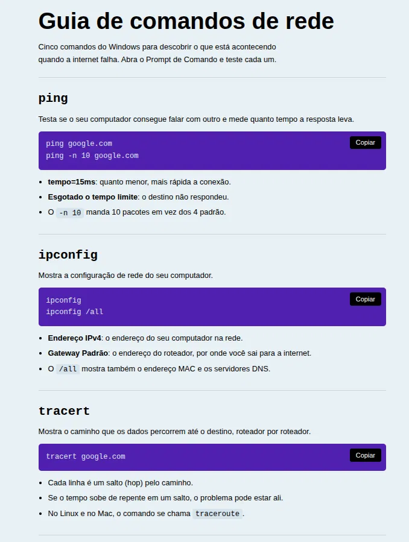

# Guia de comandos de rede

Página que explica cinco comandos de rede do Windows (`ping`, `ipconfig`, `tracert`, `nslookup` e `netstat`) e traz um roteiro de diagnóstico para quando a internet cai. Projeto de estudo em HTML, CSS e JavaScript.

🔗 **Ver o site:** https://analuizaapst-spec.github.io/guia-comandos-rede/

## O que pratiquei

- Estrutura de página com HTML (cabeçalho, seções, listas, blocos de código)
- Estilização com CSS (variáveis, box model, cores, tipografia)
- Layout que se adapta ao celular e ao computador (`media query`)
- JavaScript: botão "Copiar" em cada bloco de comando (manipulação do DOM, eventos e `navigator.clipboard`)

## Arquivos

- `index.html`: estrutura e conteúdo da página
- `style.css`: cores, layout e responsividade
- `script.js`: botão de copiar os comandos

## Como rodar localmente

Baixe a pasta e abra o `index.html` no navegador.

## Por que este tema

Surgiu dos meus estudos de redes (TCP/IP e ping), que faço junto com a graduação em Gestão da Tecnologia da Informação.
